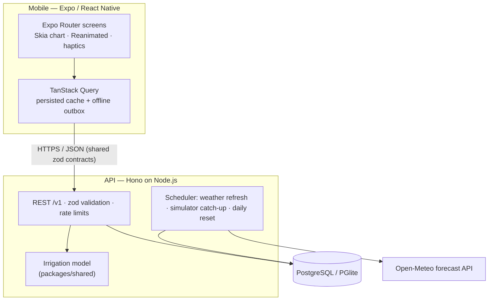

# Furrow

**Irrigation decisions for farm managers: which plots need water, how much, and why.**

https://github.com/user-attachments/assets/60b09d98-4ba6-4026-b46d-27d9c3177409

*90-second demo on the iOS simulator: the farm overview, a plot's plan and the math behind it, logging a watering, and offline sync.*

Furrow combines soil-moisture readings, the weather forecast and the FAO-56 crop water model into one instruction per plot, for example *"Irrigate tonight at 21:00 · 5 h 25 min · 54.1 m³"*. The full calculation is one tap away.

It's an open-source demo: a production-quality slice of a real product, built as a React Native app and a TypeScript API. Soil sensors are simulated. The API, database, weather integration and offline sync are real. See [PRD.md](PRD.md) for the full product spec.

## What's inside

- **Explainable recommendations.** The FAO-56 single crop coefficient method, with crop curves, root-zone water balance and RAW stress thresholds adjusted for ETc. Each recommendation exposes its inputs in a "Why?" breakdown. The model is unit-tested against FAO-56's own worked examples.
- **A chart you can scrub.** It's drawn with Skia, and the cursor follows your finger on the UI thread. You feel a haptic tick at each irrigation and each time the line crosses the refill point. The big readout number follows the finger too.
- **Offline-first logging.** Entries go into a persisted outbox (TanStack Query mutations stored in AsyncStorage). They survive the app being killed and sync exactly once when the server is reachable again, because each entry carries a client-generated UUID. "Offline" also covers *server unreachable*, not just *no network*.
- **A live, self-healing simulator.** Readings advance in 15-minute steps, using real hourly ET₀ from Open-Meteo. After a restart or a sleep, the simulator catches up from the last reading. Logging an irrigation adds the water immediately, so the chart responds within seconds.
- **A cheerful, field-ready UI.** Every plot has a crop mascot drawn with Skia, and its mood shows the plot's status (happy, thirsty, soggy, asleep). The UI uses sticker cards and rounded type (Fredoka and Nunito), and logging a watering ends with a small celebration. The light theme stays readable in direct sun. Touch targets are ≥ 48 dp, status is never shown by color alone, Dynamic Type and Reduce Motion are respected, and every screen has designed loading, empty, error and offline states.

## Demo farm

The demo is seeded in Al Ain, UAE (timezone `Asia/Dubai`). Each plot lands in a different state, computed from the live forecast so the scenario holds whatever the weather:

| Plot | Crop | Scenario |
|---|---|---|
| Field 4 | Cucumber on sand | Needs water: irrigate now |
| Block B | Date palms | Sensor offline (battery note in the log) |
| Field 5 | Lettuce on compacted loam | Overwatered: pause irrigation |
| Field 3 | Tomato on loamy sand | Irrigate tonight |
| Block A | Date palms | Optimal: next irrigation in a few days |

The demo re-seeds daily at 05:30 farm time, after the night irrigation window closes.

## Architecture



```
apps/
  api/        Hono API, Drizzle schema + migrations, simulator, demo seed, tests
  mobile/     Expo app (Expo Router, Skia, Reanimated, TanStack Query) (+ tests)
packages/
  shared/     Irrigation model, time-zone helpers, zod schemas, API types (+ tests)
```

The irrigation model is pure TypeScript in `packages/shared`. The server and the app use the same code, so the model is tested once and could later run on the device while offline.

## Getting started

You need Node.js 22 or newer, plus either the [Expo Go](https://expo.dev/go) app on your phone or an iOS simulator / Android emulator.

```bash
npm install
```

Start the API on port 8787. On first run it creates an embedded database and seeds the demo farm:

```bash
npm run dev:api
```

In a second terminal, start the app. Press `i` for the iOS simulator, or scan the QR code with Expo Go:

```bash
npm run dev:mobile
```

The app talks to port 8787 on the machine running Metro. A phone on the same Wi-Fi works with no configuration.

### Configuration

All settings are optional. See `apps/api/.env.example` and `apps/mobile/.env.example`.

| Variable | Default | Purpose |
|---|---|---|
| `DATABASE_URL` | unset → embedded PGlite in `apps/api/.data` | Postgres connection (e.g. Neon) for deployment |
| `WEATHER_PROVIDER` | `open-meteo` | `synthetic` for deterministic offline weather |
| `DEMO_NIGHTLY_RESET` / `DEMO_RESET_AT` | `true` / `05:30` | Daily re-seed of the demo farm |
| `EXPO_PUBLIC_API_URL` | Metro host, port 8787 | Point the app at a deployed API |

## Scripts

| Command | What it does |
|---|---|
| `npm run dev:api` | API with reload on change |
| `npm run dev:mobile` | Expo dev server |
| `npm run seed` | Wipe and re-seed the demo farm |
| `npm test` | Model, API and app unit tests (Vitest; the API tests use an in-memory database) |
| `npm run typecheck` | `tsc` across all workspaces |
| `npm run lint` | ESLint (typescript-eslint, react-hooks incl. React Compiler rules) |
| `npm run format` | Prettier |

CI runs format check, lint, typecheck and tests on every push.

## Decisions and trade-offs

- **Expo instead of bare React Native.** Expo is the recommended way to start a React Native app. Native folders are generated, which keeps upgrades cheap, and the app uses only modules that Expo Go ships, so anyone can open it without a custom build. That's also why storage is AsyncStorage rather than MMKV.
- **Recommendations are computed on read.** They always match the latest reading and forecast, and recomputing is cheap at this scale.
- **The simulator catches up instead of relying on cron precision.** It's idempotent and survives sleeping hosts. A real deployment would use a queue and a worker instead of the in-process scheduler.
- **PGlite locally, Postgres in production.** Clone-and-run needs no database setup, and the same migrations run everywhere.
- **Weather is cached hourly per farm.** This stays far below Open-Meteo's free-tier limits and keeps working during outages, with the cached forecast labelled as stale.

More in [PRD.md §8](PRD.md#8-technical-approach).

## Known limitations

- Sensors are simulated, and the app does not control valves.
- It uses the single-Kc method only, with no climate adjustment of Kc, no salinity or leaching requirement, and no greenhouse crops.
- There is one demo farm with no authentication.
- Push notifications and pest photos are not built yet (P1 in the PRD).

## License and data

- The code is MIT-licensed; see [LICENSE](LICENSE).
- The Fredoka and Nunito fonts (via `@expo-google-fonts`) are licensed under the SIL Open Font License 1.1. Icons come from Phosphor (MIT).
- Weather data by [Open-Meteo.com](https://open-meteo.com/), licensed [CC BY 4.0](https://creativecommons.org/licenses/by/4.0/). The free API is for non-commercial use, so a commercial deployment would need a paid plan.
- Crop coefficients, rooting depths, depletion fractions and soil water ranges come from Allen et al. (1998), *Crop evapotranspiration*, [FAO Irrigation and Drainage Paper 56](https://www.fao.org/4/x0490e/x0490e00.htm).
